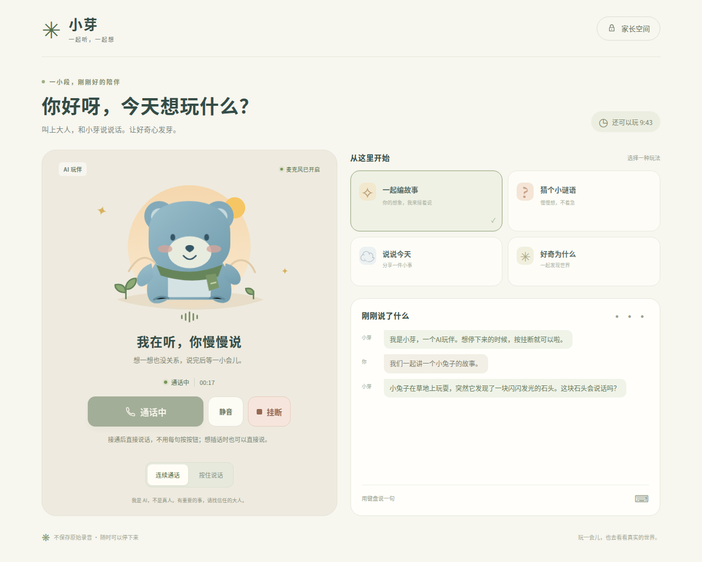

# 小芽家庭语音玩伴

给一位孩子与照护者共同使用的本地语音网页。已在这台机器完成开发、本地小模型部署、真实语音端到端及并发压力测试。默认不调用云端API，不保存对话录音或聊天记录；家长主动创建音色时的参考录音仅在本机保存并可删除。建议先由成人操作，再陪同孩子使用。

提供一起编故事、固定谜题、日常聊天和好奇问答；默认使用电话模式：点一次拨打后连续交流，自动断句和接话；支持讲话打断、静音、挂断，也可手动选择按住说话。保留家长权限、限时和有限偏好。开场会说明AI身份。谜题采用经过核对的题库，避免小模型编出不一致的谜面。

## 在当前机器开始使用

依赖与模型已安装在项目内，无需重新下载。测试进程在交付时停止，启动命令如下：

```bash
cd /home/timocy/babybot
.venv/bin/python scripts/manage.py start
.venv/bin/python scripts/warmup.py
```

打开 [小芽](http://127.0.0.1:8765)，进入“家长空间”。家庭口令与家长验证码保存在仅本机用户可读的 `.runtime/credentials.json`；不要把该文件放进分享包。首次点击“拨打小芽”后，允许浏览器使用麦克风；接通后每轮直接说话，无需再点按钮。

```bash
# 查看服务状态
.venv/bin/python scripts/manage.py status
# 结束应用和模型进程
.venv/bin/python scripts/manage.py stop
```

默认仅监听本机。手机访问需要受信任的HTTPS、配置明确的来源地址，以及实际设备验收，见使用手册。

## 音色选择与自己的声音

0.3.0提供原声、四种中文预设音色，以及本地参考录音克隆。进入家长空间解锁后可试听、保存或删除；支持直接录音或上传已有音频。个人音色需录入自己的声音后试听确认，本次测试使用合成参考素材。操作见[音色使用指南](docs/VOICE_GUIDE.md)。

## 交付文档

- [使用手册](docs/USER_MANUAL.md)：启动、授权、玩法、家长设置、故障处理和手机接入。
- [实现文档](docs/IMPLEMENTATION.md)：架构、协议、会话控制、审核、数据边界及扩展方式。
- [测试报告](docs/TEST_REPORT.md)：原始证据、测试结果、性能口径、已知限制。
- [安全降级说明](docs/FALLBACK_REVIEW.md)：两次普通输入降级的证据、已知原因与诊断字段。
- [模型与安装说明](models/README.md)：权重来源、许可、校验、依赖和重新安装。

## 已测结果与边界

0.3.0后端132项、前端33项通过；真实预设男女声与合成参考克隆的完整模型链路、8请求小并发及浏览器7项操作验收完成。克隆音色下的完整连续通话首次9/9通过。音色相似度未评估；历史审核失败继续保留。详见测试报告中的0.3.0验收。

0.2.0电话模式的后端控制回归92项、前端21项通过。电话浏览器8项功能检查通过，但普通输入仍有两次审核降级，“至少三轮完整生成播放”的严格门槛未通过。详见测试报告中的0.2.0增量验收。以下完整压力与审核结果来自保留的0.1.0基线。真实语音链路曾6/6通过；加强安全策略后的严格端到端验收为4/6，另外两个普通场景触发安全降级。最终浏览器单次录音完整链路通过。150请求主压力测试得到67次正常生成、3次安全审核降级和80次明确过载拒绝；策略修订后30请求回归得到13次生成、1次安全降级和16次过载拒绝。两轮完整压力均无模型超时或传输错误，负载后恢复正常。严格的“零降级”门槛未通过，不能写成全部测试通过。

1.5B模型独立审核初测18/20，策略加强后20/21；扩大至37个定向样例后34/37，仍有两条危险漏判和一条误拒。已发现的身份伪装、野外采食、窗台跳跃和触摸热锅问题由输出规则补救，并有回归测试；这不构成儿童安全保证。浏览器语音验收使用合成WAV和虚拟麦克风，没有使用真实儿童录音，也没有完成实体Android/iOS、外放回声和童声适配验收。

默认模型为Qwen2.5-1.5B Q4_K_M、SenseVoiceSmall int8、MeloTTS；可选Kokoro多音色与ZipVoice本地克隆，均为CPU推理。云端文本模型预设默认关闭，仅做了协议替身测试；本次没有使用付费云账户或向云端提交测试音频。



## 重新运行验收

```bash
# 控制回归，使用故障注入替身，不等于真实模型测试
.venv/bin/python -m pytest tests -q --timeout=20
node tests/frontend/audio.test.cjs
node tests/frontend/session.test.cjs

# 下列测试要求本地服务已启动并预热
.venv/bin/python scripts/test_e2e.py
.venv/bin/python scripts/test_voice_hangup.py
# 电话浏览器测试需要本机Playwright/Chrome，路径见测试报告
node scripts/test_call_browser.cjs
.venv/bin/python scripts/stress_test.py --rounds 10 --concurrency 1 2 4 8 --require-overload
```

压力脚本在有安全降级、模型故障或恢复失败时会返回非零状态；请读取JSON中的分类，不要绕过审核来追求全绿。测试用量计入所连接家庭的每日额度，复测时建议设置单独的 `BABYBOT_DATA_DIR`，不要修改日常家庭数据库来迁就测试。

所有生成模型、语音运行时与依赖均在本项目目录，未修改系统Python、现有模型目录或其他运行中的任务。
